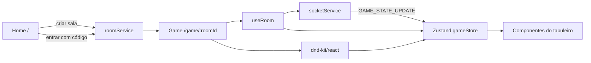

# GobDash Online - Front-end

Implementação web do jogo de tabuleiro GobDash. A aplicação permite criar ou entrar em uma sala e jogar uma partida pelo navegador, com uma interface baseada em cartas, fases de turno e operações de arrastar e soltar.

## Visão geral

O front-end é uma aplicação React 19 construída com React Router 8 em **Framework Mode**. O React Router cuida da configuração das rotas, dos módulos de rota, da geração de tipos e do pipeline de build com Vite.

Atualmente, a partida pode ser executada localmente em modo mock. A camada de salas e o cliente WebSocket já possuem contratos e pontos de integração para um backend, mas usam respostas simuladas por padrão.



## Arquitetura

### Rotas e shell da aplicação

As rotas são declaradas manualmente em `app/routes.ts`:

- `/`: tela inicial para criar uma sala ou entrar usando um código.
- `/game/:roomId?`: mesa de jogo. O parâmetro da sala é opcional para facilitar o desenvolvimento local.

`app/root.tsx` funciona como o shell global. Ele configura o documento HTML, fontes externas, estilos globais, `Outlet`, restauração de scroll, scripts e o rodapé.

O projeto está configurado em SPA Mode (`ssr: false` em `react-router.config.ts`). Essa decisão mantém o jogo no navegador e evita depender de renderização no servidor para bibliotecas que usam APIs de browser, especialmente o sistema de drag-and-drop.

### Estado e regras da partida

O estado global fica em `app/store/gameStore.ts`, usando Zustand. A store reúne:

- conexão, sala e jogador;
- mão, mesa, descarte e quantidade de cartas no baralho;
- cartas posicionadas nos slots e tokens de código;
- fase do turno (`use` ou `buy`) e número do turno;
- ações de inicialização, drag-and-drop, confirmação de uso/compra e reset;
- aplicação de atualizações parciais recebidas do servidor.

`useGameState` é um hook fino que expõe a store para as rotas, mantendo a implementação da tela do jogo mais concentrada na composição dos componentes.

O domínio de cartas está em `app/types/game.ts` e `app/types/constants.ts`. `Card`, `Recipe`, `Ingredient` e `DeckOfCards` representam o modelo atual; o baralho local é embaralhado e distribuído (atualmente, no cliente, mas no futuro na API) durante a inicialização da partida.

### Salas e comunicação

`app/hooks/useRoom.ts` controla o ciclo de vida da sala:

1. registra a sala no estado;
2. inicia a conexão;
3. escuta eventos `GAME_STATE_UPDATE`;
4. aplica o payload parcial na store;
5. remove listeners, fecha a conexão e sinaliza a saída ao desmontar a rota.

As integrações estão isoladas em dois serviços:

- `roomService`: cliente REST para criar, entrar e sair de salas;
- `socketService`: wrapper singleton do WebSocket, com registro tipado de handlers e envio de eventos.

Ambos começam em modo mock por padrão. Para conectar a um backend real, use o
modo `api` e configure as URLs/rotas compatíveis com os contratos de
`app/types/server.ts`.

A configuração fica centralizada em `app/config.ts`. Os valores são fornecidos
pelos arquivos `.env.mock` e `.env.api`, selecionados pelo modo do Vite:

- `npm run dev` e `npm run build`: modo mock (offline).
- `npm run dev:api`: desenvolvimento usando a API e o WebSocket configurados em `.env.api`.
- `npm run build:api`: build usando a API e o WebSocket configurados em `.env.api`.

Para apontar para outro backend, altere apenas `VITE_API_BASE_URL` e
`VITE_SOCKET_BASE_URL` em `.env.api`. Variáveis `VITE_*` são incorporadas ao
bundle no build, portanto não devem conter segredos.

### Interface do jogo

`app/routes/game.tsx` coordena a tela da partida e conecta os componentes às ações da store. O tabuleiro é dividido em componentes especializados em `app/components/game/`, como mão do jogador, mesa, baralho, descarte, slots de ação, tokens e botão de fase.

O fluxo de interação usa `@dnd-kit/react`:

- cartas podem ser arrastadas durante a fase de uso;
- uma carta pode ser colocada em um slot de ação ou no descarte;
- tokens `program` e `error` podem ser colocados sobre cartas;
- a fase de compra bloqueia o arraste e permite selecionar uma carta da mesa ou do topo do baralho.

As regras de destino e os identificadores dos slots ficam centralizados em `app/lib/slots.ts`, evitando que os componentes precisem conhecer convenções de string espalhadas pelo código.

## Principais bibliotecas

- **React 19** e **React DOM**: composição da interface.
- **React Router 8** (`react-router`, `@react-router/dev`, `@react-router/node`, `@react-router/serve`): Framework Mode, rotas, tipos e execução da aplicação.
- **Vite 8**: bundling e servidor de desenvolvimento, integrado ao plugin do React Router.
- **TypeScript 5**: tipagem estrita e aliases de importação `~/*` para `app/*`.
- **Zustand**: estado global e transições do jogo.
- **@dnd-kit/react**: drag-and-drop de cartas e tokens.
- **Tailwind CSS 4**: layout e utilitários de estilo.
- **Flowbite / Flowbite React**: tema e componentes de interface, incluindo toasts.
- **Motion**: animações de elementos de feedback.
- **React Icons**: ícones usados em componentes da interface.
- **isbot**: dependência do ecossistema React Router para tratamento relacionado a user agents de bots.

## Estrutura de pastas

```text
app/
	components/       Componentes visuais reutilizáveis
		game/           Mesa, cartas, slots, tokens e fluxo de turno
		room/           Informações da sala
		ui/             Loading, toast e controles genéricos
	hooks/            Orquestração de estado e ciclo da sala
	lib/              Convenções compartilhadas, como IDs de slots
	routes/           Módulos das páginas home e game
	services/         Clientes REST e WebSocket
	store/            Store Zustand do jogo
	types/            Modelos do domínio e contratos cliente-servidor
	app.css           Tailwind, Flowbite e tema visual do projeto
	root.tsx          Documento e shell global
	routes.ts         Configuração das rotas
public/images/      Cartas, tokens e assets servidos diretamente
```

## Desenvolvimento

Requisitos: Node.js compatível com as versões usadas no projeto e npm.

```bash
npm install
npm run dev
```

Comandos disponíveis:

```bash
npm run dev        # servidor de desenvolvimento
npm run dev:api    # desenvolvimento com o backend real
npm run typecheck  # gera tipos do React Router e executa o TypeScript
npm run build      # build de produção
npm run build:api  # build de produção com o backend real
npm run start      # serve o build gerado
```

O servidor de desenvolvimento normalmente fica disponível em `http://localhost:5173`.

## Publicação no GitHub Pages

O workflow [deploy-pages.yml](../.github/workflows/deploy-pages.yml) publica
automaticamente a versão mock no GitHub Pages a cada push na branch `main`.
Ele também pode ser executado manualmente pela aba **Actions** do GitHub.

Na primeira publicação, configure o repositório em **Settings > Pages**,
selecionando **GitHub Actions** como origem da publicação. Depois que o
workflow terminar, a aplicação ficará disponível em:

`https://isa56.github.io/gobdash-online/`

O build usa o caminho `/gobdash-online/` para funcionar como um site de projeto
GitHub Pages e cria um `404.html` para manter as rotas da SPA acessíveis após
recarregar a página.

## Estado atual e próximos pontos de integração

- Tabuleiro ainda não foi implementado, nem o movimento dentro dele.
- A aplicação roda offline com dados e comunicação mockados.
- O WebSocket está preparado para eventos tipados de entrada e saída, mas `mockMode` está habilitado em `socketService`.
- O REST de salas também está mockado em `roomService`.
- O estado local inicial é criado no cliente; atualizações parciais do servidor já podem ser mescladas na store.
- Ainda é necessário conectar os serviços a um backend real e definir a autoridade final das regras da partida para uma experiência multiplayer consistente.
